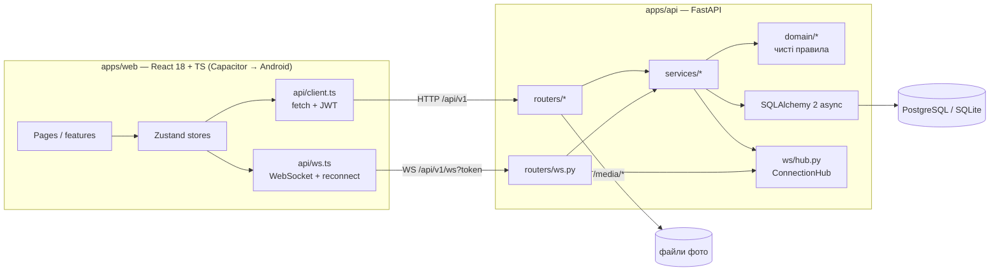
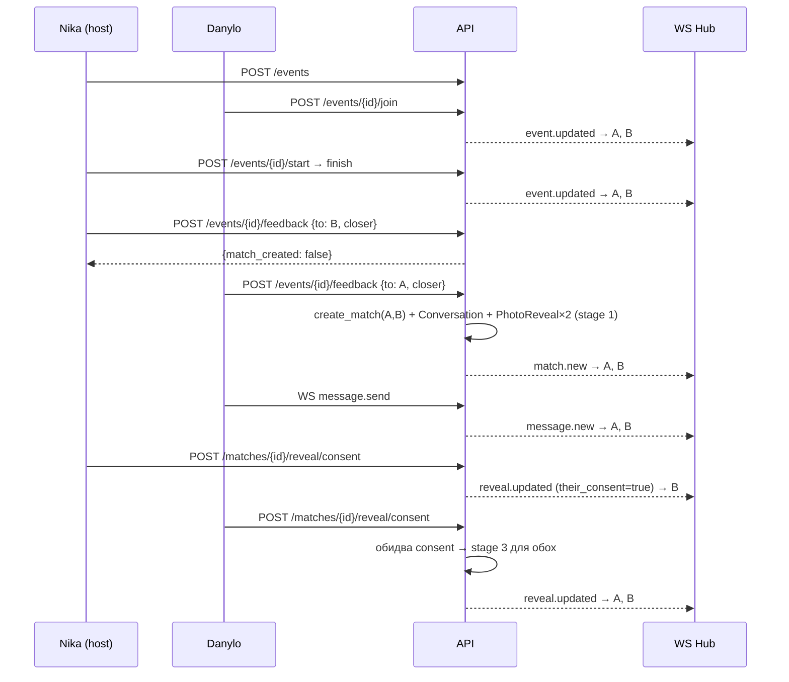

# Архітектура Teamate

Трирівнева архітектура: мобільний клієнт (React, пакується в Android через Capacitor) → REST + WebSocket API (FastAPI) → PostgreSQL (у Docker) або SQLite (локально без Docker).

## Шари бекенду

| Шар | Директорія | Відповідальність | Тестується |
|---|---|---|---|
| Domain | `app/domain/` | Чисті функції: стан-машина івенту, правила метчу, стадії reveal, формула сумісності. Жодного I/O. | `tests/domain/` без БД |
| Services | `app/services/` | Транзакції, перевірка прав, виклик доменних правил, розсилка WebSocket-подій | `tests/api/` через HTTP |
| Routers | `app/routers/` | Тонкі HTTP-обгортки: валідація Pydantic → сервіс → схема відповіді | `tests/api/` |
| Models | `app/models/` | SQLAlchemy-таблиці (див. [data-model.md](data-model.md)) | |
| WS hub | `app/ws/hub.py` | `dict[user_id, set[WebSocket]]` у пам'яті процесу; `send_to_user(s)` | `tests/api/test_chat.py` |

**Чому домен окремо.** Правила на кшталт «метч тільки при взаємному *closer*» або «фото стає чітким лише за згодою обох» — це продукт. Вони мають читатись і перевірятись без FastAPI та БД. Сервіси лише «підключають» їх до сховища.

## Потік «івент → метч → reveal»

## Клієнт

- **Стори** (`src/stores/`): `auth` (токен, `me`), `events`, `matches`, `chat`. Кожен стор підписується на свої WebSocket-події при створенні, тож будь-який екран отримує оновлення без polling.
- **Токен у `sessionStorage`** — дві вкладки браузера = два різні акаунти. Це свідоме рішення для демо.
- **Дизайн-система** (`src/design-system/`): токени в CSS-змінних, примітиви `PhantomButton`, `Panel`, `Chip`, `Field`, `TopBar`, `TabBar`, `Wipe`, `Stamp`, `Avatar`. Див. [design-system.md](design-system.md).
- **Маршрути** (`src/app/App.tsx`): публічні (`/welcome`, `/login`, `/register`), онбординг (3 кроки), таби (`/events`, `/discover`, `/matches`, `/me`), деталі (`/events/:id`, `/events/:id/feedback`, `/match/:id`, `/chat/:conversationId`, `/likes`). `Protected` перенаправляє не-онбордженого користувача в `/onboarding/dna`; `MatchInterrupt` відкриває екран метчу, щойно прийшла подія `match.new`.

## Обмеження MVP і як їх знімати

| Обмеження | Наслідок | Шлях далі |
|---|---|---|
| WS hub у пам'яті одного процесу | Працює лише з одним інстансом API | Redis pub/sub між інстансами ([ADR-0004](adr/0004-in-memory-ws-hub.md)) |
| `create_all` замість міграцій | Зміна схеми = перестворити БД | Alembic |
| Фото у локальній папці `media/` | Не масштабується, немає CDN | S3-сумісне сховище |
| Преміум — прапорець без оплати | Немає реальної монетизації | Stripe / Google Play Billing |
| Немає верифікації акаунтів | Ризик фейків | Селфі-перевірка, прив'язка Steam/Discord |
