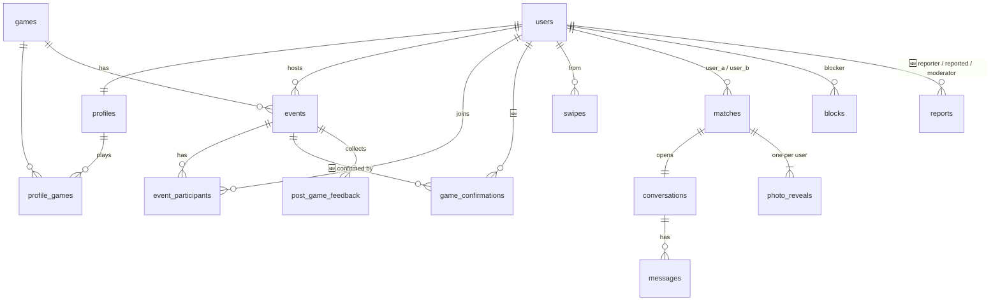

# Контракт: схема збереження даних

> **КТ4, крок 3.** Структура таблиць, типи полів, ключі, зв'язки й обмеження під 19 історій MVP.
> Джерело правди для коду — `apps/api/app/models/`. Цей документ описує і те, що вже є (✅), і те, що додається під історії MVP (🆕). Не можна додавати поле в модель, якого немає тут, і навпаки: спершу змінюємо контракт, потім код.
> Промпт: [prompts/4.3_technical_contracts.md](../../prompts/4.3_technical_contracts.md). Рішення про сховище: [ADR-0007](../adr/0007-relational-db-sqlalchemy.md).

## Загальні правила

| Правило | Значення |
|---|---|
| СУБД | SQLite (локально, файл `apps/api/teamate.db`) і PostgreSQL 16 (Docker). Одна схема для обох |
| Первинні ключі | `uuid` v4, генерує сервер (`new_uuid`). Таблиці-зв'язки мають складений PK |
| Час | `timestamptz`, завжди UTC (`utcnow`). У кожній сутності є `created_at` |
| Перелічення | Enum зберігається як рядок з фіксованим набором значень (див. розділ «Enum-и») |
| Списки | Короткі списки, що читаються цілком (`modes`, `schedule`), — JSON-масив рядків |
| Видалення | Каскадне від `users`: видалення акаунта видаляє профіль, участі, свайпи, метчі, повідомлення |
| Створення схеми | `Base.metadata.create_all` під час старту API. Перевірка підключення: `GET /api/v1/health/db` |
| Демо-дані | `python -m app.seed` (ідемпотентно): 12 акаунтів, 12 ігор, 8 івентів, бот Guide |

## ER-діаграма

## Таблиці

Позначки в колонці «Обмеження»: **PK** — первинний ключ, **FK** — зовнішній ключ, **UQ** — унікальність, **IX** — індекс, **NN** — not null.

### `users` — акаунт ✅

| Поле | Тип | Обмеження | За замовчуванням | Опис |
|---|---|---|---|---|
| `id` | uuid | PK | `uuid4()` | |
| `email` | varchar(255) | NN, UQ, IX | | Зберігається в нижньому регістрі |
| `password_hash` | varchar(255) | NN | | bcrypt. Ніколи не потрапляє у відповіді API |
| `display_name` | varchar(40) | NN | | 2–40 символів |
| `birth_date` | date | NN | | Вік рахується з неї; у відповідях лише `age` |
| `is_premium` | bool | NN | `false` | Teamate+ без оплати |
| `is_bot` | bool | NN | `false` | Демо-компаньйон Guide |
| `role` 🆕 | enum `UserRole` | NN | `user` | `user` або `moderator` (US-10) |
| `banned_at` 🆕 | timestamptz | | `null` | Заповнюється рішенням модератора; такий акаунт отримує 403 `ACCOUNT_BANNED` (US-10) |
| `created_at` | timestamptz | NN | `now()` | |

### `profiles` — профіль і Ігрова ДНК ✅ (1:1 з `users`)

| Поле | Тип | Обмеження | За замовчуванням | Опис |
|---|---|---|---|---|
| `user_id` | uuid | PK, FK → `users.id` ON DELETE CASCADE | | |
| `bio` | text | NN | `''` | ≤ 300 символів (валідація схеми) |
| `avatar_key` | enum `AvatarKey` | NN | `operator` → 🆕 `duelist` | Маска героя (US-18, прогалина G-02) |
| `accent_color` | varchar(7) | NN | `#E60012` | `#RRGGBB` |
| `photo_url` | varchar(512) | | `null` | ✅ зараз публічний URL. 🆕 замінюється на `photo_key` ([ADR-0010](../adr/0010-private-photo-storage.md)) |
| `photo_key` 🆕 | varchar(64) | | `null` | Ім'я файлу в приватному сховищі; розмиті копії мають суфікси `_s1`, `_s2` |
| `modes` | json (масив `Mode`) | NN | `[]` | `duo`, `friends`, `dating` (US-03) |
| `role` | enum `Role` | | `null` | Роль у грі |
| `playstyle` | enum `Playstyle` | | `null` | |
| `comms` | enum `Comms` | | `null` | Голос чи текст |
| `schedule` | json (масив рядків) | NN | `[]` | Наприклад `["fri-evening"]` |
| `toxicity_tolerance` | int | NN | `3` | 1–5 |
| `timezone` | varchar(64) | NN | `Europe/Kyiv` | Для «сьогодні» і денного ліміту лайків |

Похідне поле `onboarded = modes ≠ [] AND role ≠ null AND є ≥ 1 profile_games` (BR-03).

### `profile_games` — улюблені ігри ✅

| Поле | Тип | Обмеження | Опис |
|---|---|---|---|
| `profile_id` | uuid | PK, FK → `profiles.user_id` CASCADE | |
| `game_id` | uuid | PK, FK → `games.id` CASCADE | |
| `rank` | varchar(40) | | Необов'язковий ранг |

### `games` — довідник ігор ✅

| Поле | Тип | Обмеження | За замовчуванням | Опис |
|---|---|---|---|---|
| `id` | uuid | PK | | |
| `name` | varchar(80) | NN | | |
| `slug` | varchar(80) | NN, UQ | | |
| `is_chill` | bool | NN | `false` | Дозволена для Game Date |
| `cover_color` | varchar(7) | NN | `#2A2A2A` | |

### `events` — івент ✅

| Поле | Тип | Обмеження | За замовчуванням | Опис |
|---|---|---|---|---|
| `id` | uuid | PK | | |
| `host_id` | uuid | NN, FK → `users.id` CASCADE | | Хост — перший учасник (BR-07) |
| `game_id` | uuid | NN, FK → `games.id` | | |
| `kind` | enum `EventKind` | NN | `squad` | `game_date` — завжди 2 місця |
| `title` | varchar(80) | NN | | 3–80 символів |
| `starts_at` | timestamptz | NN | | 🆕 не в минулому на момент створення (G-07) |
| `max_slots` | int | NN | `2` | 2–10 |
| `status` | enum `EventStatus` | NN | `open` | Машина станів у [technical-analysis.md](../technical-analysis.md#22-івент) |
| `is_official` 🆕 | bool | NN | `false` | Teamate Night; ставить лише модератор/seed (US-05) |
| `started_at` 🆕 | timestamptz | | `null` | Момент «Старт» |
| `finished_at` 🆕 | timestamptz | | `null` | «Завершити» або `started_at + 3 год` |
| `counted_at` 🆕 | timestamptz | | `null` | Гру зараховано (≥ 15 хв і ≥ 2 підтвердження). Від нього відлік 24 год (BR-12) |
| `created_at` | timestamptz | NN | `now()` | |

Індекс 🆕: `IX(status, starts_at)` для стрічки «на сьогодні».

### `event_participants` — учасники ✅

| Поле | Тип | Обмеження | Опис |
|---|---|---|---|
| `event_id` | uuid | PK, FK → `events.id` CASCADE | |
| `user_id` | uuid | PK, FK → `users.id` CASCADE | Складений PK забороняє приєднатися двічі (BR-08) |
| `joined_at` | timestamptz | NN | |

### `game_confirmations` — підтвердження гри 🆕 (US-07)

| Поле | Тип | Обмеження | Опис |
|---|---|---|---|
| `event_id` | uuid | PK, FK → `events.id` CASCADE | |
| `user_id` | uuid | PK, FK → `users.id` CASCADE | Лише учасник цього івенту (перевіряє сервіс) |
| `created_at` | timestamptz | NN | |

### `post_game_feedback` — «Зіграємо ще?» ✅

| Поле | Тип | Обмеження | Опис |
|---|---|---|---|
| `id` | uuid | PK | |
| `event_id` | uuid | NN, FK → `events.id` CASCADE | |
| `from_user_id` | uuid | NN, FK → `users.id` CASCADE | |
| `to_user_id` | uuid | NN, FK → `users.id` CASCADE | |
| `answer` | enum `FeedbackAnswer` | NN | `again`, `closer`, `no` |
| `created_at` | timestamptz | NN | Має бути < `events.counted_at + 24 год` 🆕 |

`UQ(event_id, from_user_id, to_user_id)` — `uq_feedback_pair`: одна відповідь на пару в межах івенту.

### `swipes` — свайпи ✅

| Поле | Тип | Обмеження | Опис |
|---|---|---|---|
| `id` | uuid | PK | |
| `from_user_id` | uuid | NN, FK → `users.id` CASCADE | |
| `to_user_id` | uuid | NN, FK → `users.id` CASCADE | |
| `direction` | enum `SwipeDirection` | NN | `right` рахується в денний ліміт 20, `left` — ні (BR-16) |
| `created_at` | timestamptz | NN | Для ліміту за добу |

`UQ(from_user_id, to_user_id)` — `uq_swipe_pair`.

### `matches` — метчі ✅

| Поле | Тип | Обмеження | Опис |
|---|---|---|---|
| `id` | uuid | PK | |
| `user_a_id` | uuid | NN, FK → `users.id` CASCADE | Завжди менший UUID пари (`canonical_pair`) |
| `user_b_id` | uuid | NN, FK → `users.id` CASCADE | Більший UUID пари |
| `source` | enum `MatchSource` | NN | `post_game` або `mutual_like` |
| `created_at` | timestamptz | NN | |

`UQ(user_a_id, user_b_id)` — `uq_match_pair`: один метч на пару (BR-15).

### `conversations` — розмова метчу ✅ (1:1 з `matches`)

| Поле | Тип | Обмеження | Опис |
|---|---|---|---|
| `id` | uuid | PK | |
| `match_id` | uuid | NN, UQ, FK → `matches.id` CASCADE | |
| `created_at` | timestamptz | NN | |

### `messages` — повідомлення ✅

| Поле | Тип | Обмеження | Опис |
|---|---|---|---|
| `id` | uuid | PK | |
| `conversation_id` | uuid | NN, IX, FK → `conversations.id` CASCADE | |
| `sender_id` | uuid | NN, FK → `users.id` CASCADE | |
| `body` | text | NN | 1–2000 символів після `strip()` |
| `created_at` | timestamptz | NN | Сортування історії |

### `photo_reveals` — стадія фото ✅ (рівно 2 рядки на метч)

| Поле | Тип | Обмеження | За замовчуванням | Опис |
|---|---|---|---|---|
| `match_id` | uuid | PK, FK → `matches.id` CASCADE | | |
| `user_id` | uuid | PK, FK → `users.id` CASCADE | | Чиє фото |
| `stage` | int | NN | `1` | 1–3; стадія 0 — це відсутність метчу, рядка немає |
| `consent_next` | bool | NN | `false` | Власник натиснув «Показати» |
| `early_request` | bool | NN | `false` | Teamate+ (Post-MVP) |

### `blocks` — блокування ✅

| Поле | Тип | Обмеження | Опис |
|---|---|---|---|
| `blocker_id` | uuid | PK, FK → `users.id` CASCADE | |
| `blocked_id` | uuid | PK, FK → `users.id` CASCADE | |
| `created_at` | timestamptz | NN | |

Логіка симетрична: `blocked_ids(user)` повертає обидва напрями (BR-21).

### `reports` — скарги й рішення модератора 🆕 (US-09, US-10)

| Поле | Тип | Обмеження | За замовчуванням | Опис |
|---|---|---|---|---|
| `id` | uuid | PK | | |
| `reporter_id` | uuid | NN, FK → `users.id` CASCADE | | Ніколи не віддається тому, на кого скаржаться (NEVER-06) |
| `reported_id` | uuid | NN, FK → `users.id` CASCADE | | |
| `context` | enum `ReportContext` | NN | | `event`, `chat`, `photo` |
| `context_id` | uuid | NN | | id івенту, розмови або метчу |
| `reason` | enum `ReportReason` | NN | | Обов'язкова (BR-23) |
| `comment` | varchar(500) | | `null` | Необов'язковий опис |
| `status` | enum `ReportStatus` | NN, IX | `new` | `new`, `dismissed`, `warned`, `banned` |
| `moderator_id` | uuid | FK → `users.id` | `null` | Хто ухвалив рішення |
| `decided_at` | timestamptz | | `null` | Коли |
| `created_at` | timestamptz | NN | `now()` | |

Перевірка: `reporter_id ≠ reported_id`.

## Enum-и

| Enum | Значення | Статус |
|---|---|---|
| `EventStatus` | `open`, `full`, `in_progress`, `finished`, `cancelled` | ✅ |
| `EventKind` | `squad`, `game_date` | ✅ |
| `FeedbackAnswer` | `again`, `closer`, `no` | ✅ |
| `SwipeDirection` | `left`, `right` | ✅ |
| `MatchSource` | `post_game`, `mutual_like` | ✅ |
| `Mode` | `duo`, `friends`, `dating` | ✅ |
| `Role` | `support`, `carry`, `flex`, `tank`, `igl` | ✅ |
| `Playstyle` | `casual`, `competitive` | ✅ |
| `Comms` | `voice`, `text`, `both` | ✅ |
| `AvatarKey` | `duelist`, `sage`, `impostor`, `builder`, `pilot`, `operator`, `vanguard`, `strategist` | ✅ |
| `UserRole` | `user`, `moderator` | 🆕 |
| `ReportContext` | `event`, `chat`, `photo` | 🆕 |
| `ReportReason` | `harassment`, `inappropriate_photo`, `underage`, `spam`, `other` | 🆕 |
| `ReportStatus` | `new`, `dismissed`, `warned`, `banned` | 🆕 |

## Ключові рішення по схемі

- **`matches.user_a_id < user_b_id` + `uq_match_pair`.** Пара не може мати два метчі, звідки б вони не прийшли.
- **`photo_reveals` — по рядку на кожного учасника.** `stage` описує, наскільки чітко *моє* фото бачить співрозмовник. Кожен контролює лише своє фото ([ADR-0003](../adr/0003-per-user-reveal.md)).
- **Зарахування гри — поле `events.counted_at`, а не новий статус.** Enum `EventStatus` і клієнт не змінюються, а «гра зарахована» читається одним полем.
- **Підтвердження гри — окрема таблиця**, а не лічильник: складений PK не дає одній людині підтвердити двічі, і видно, хто саме підтвердив.
- **Скарга і рішення — одна таблиця.** Рішення завжди одне на скаргу, окрема таблиця нічого не додає для MVP.
- **`profiles.modes` і `schedule` — JSON-масиви.** Це короткі списки, які завжди читаються цілком.
- **`users.is_bot`** позначає демо-компаньйона Guide (`services/bot.py`).

## Відповідність історіям

| Історія | Таблиці | Обмеження, що тримають правило |
|---|---|---|
| US-01 | `users` | UQ `email`; вік з `birth_date` |
| US-02, US-18, US-03 | `profiles`, `profile_games` | default `avatar_key`, default `modes = []` |
| US-04, US-16, US-17 | `profiles.photo_key`, `photo_reveals` | PK (`match_id`, `user_id`) |
| US-05, US-06, US-19 | `events`, `event_participants` | PK (`event_id`, `user_id`), `max_slots` |
| US-07 | `events.started_at/finished_at/counted_at`, `game_confirmations` | PK (`event_id`, `user_id`) |
| US-08 | `blocks` | PK (`blocker_id`, `blocked_id`) |
| US-09, US-10 | `reports`, `users.role`, `users.banned_at` | `reporter_id ≠ reported_id` |
| US-11, US-12 | `post_game_feedback`, `matches` | `uq_feedback_pair`, `uq_match_pair` |
| US-13 | `swipes`, `matches` | `uq_swipe_pair` |
| US-14, US-15 | `conversations`, `messages` | UQ `match_id` |
