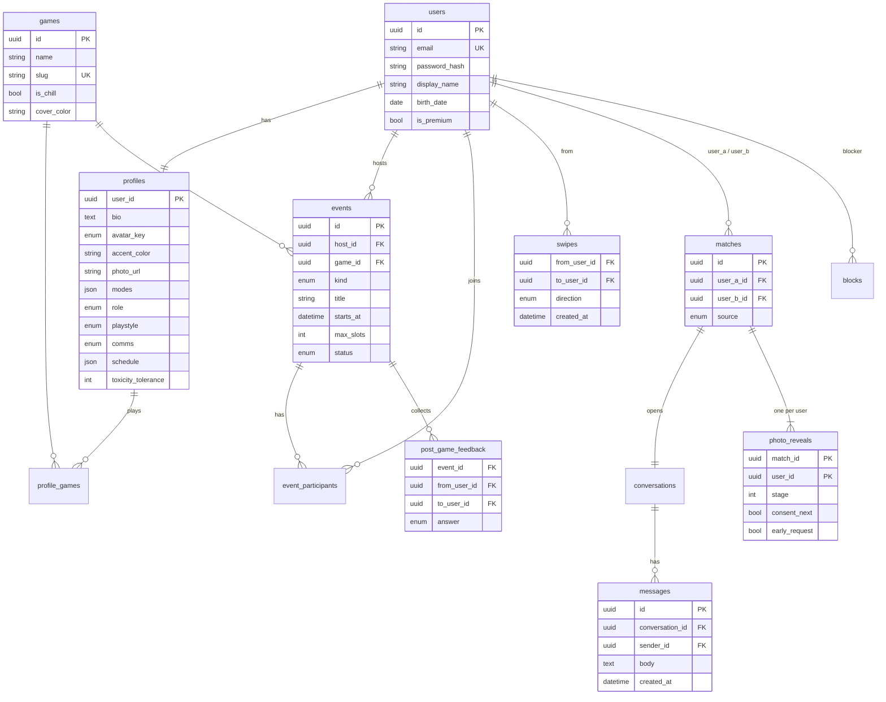

# Модель даних

Усі первинні ключі — UUID, час — UTC. Схема створюється через `Base.metadata.create_all` під час старту API (для MVP; далі — Alembic).

## Ключові рішення

- **`matches.user_a_id < user_b_id`** (`canonical_pair`) + unique-констрейнт — пара не може мати два метчі, звідки б вони не прийшли (після гри чи взаємний лайк).
- **`photo_reveals` — по одному рядку на кожного учасника метчу.** `stage` описує, наскільки чітко *мій* профіль показаний співрозмовнику. Кожен користувач контролює тільки своє фото ([ADR-0003](adr/0003-per-user-reveal.md)).
- **`post_game_feedback` унікальний по (event, from, to)** — оцінити тіммейта можна один раз; відповідь приватна, поки не стане взаємним *closer*.
- **`profiles.modes` та `schedule` — JSON-масиви**, а не окремі таблиці: це невеликі списки enum-значень, які читаються завжди цілком.
- **`blocks` симетричний у логіці:** `blocked_ids(user)` повертає і тих, кого заблокував користувач, і тих, хто заблокував його.

## Enum-и

| Enum | Значення |
|---|---|
| `EventStatus` | `open`, `full`, `in_progress`, `finished`, `cancelled` |
| `EventKind` | `squad`, `game_date` |
| `FeedbackAnswer` | `again`, `closer`, `no` |
| `SwipeDirection` | `left`, `right` |
| `MatchSource` | `post_game`, `mutual_like` |
| `Mode` | `duo`, `friends`, `dating` |
| `Role` | `support`, `carry`, `flex`, `tank`, `igl` |
| `Playstyle` | `casual`, `competitive` |
| `Comms` | `voice`, `text`, `both` |
| `AvatarKey` | `raven`, `jester`, `kitsune`, `marionette`, `sentinel`, `vesper`, `nomad`, `oracle` |
