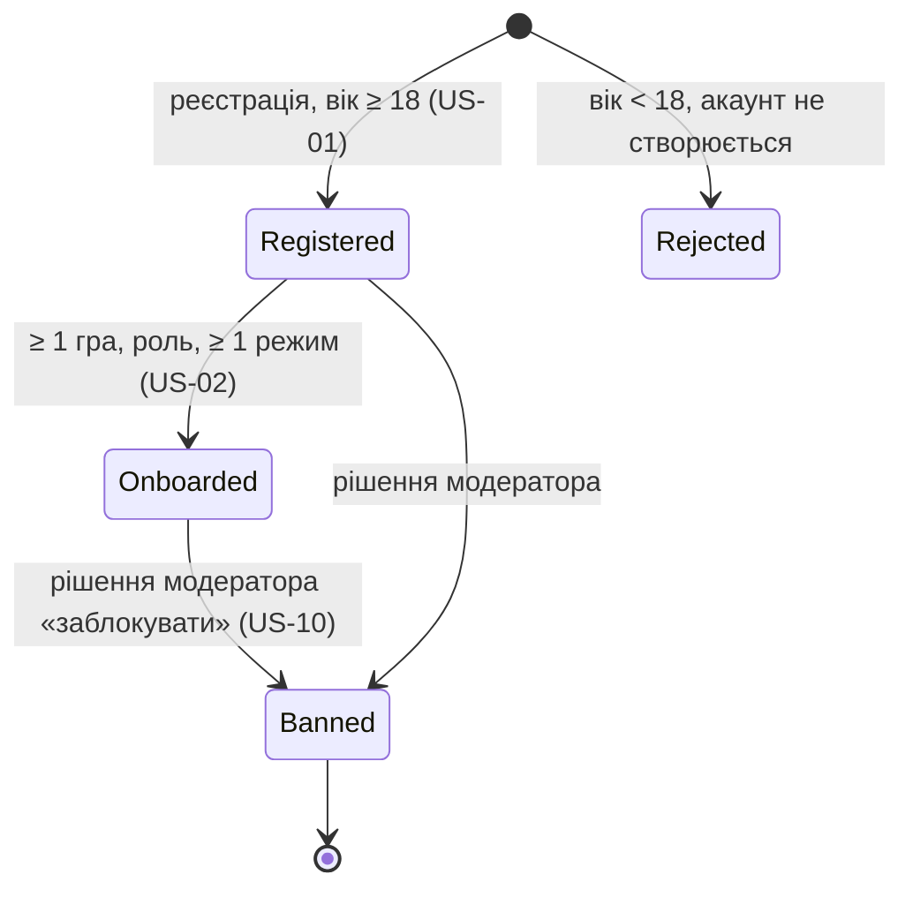
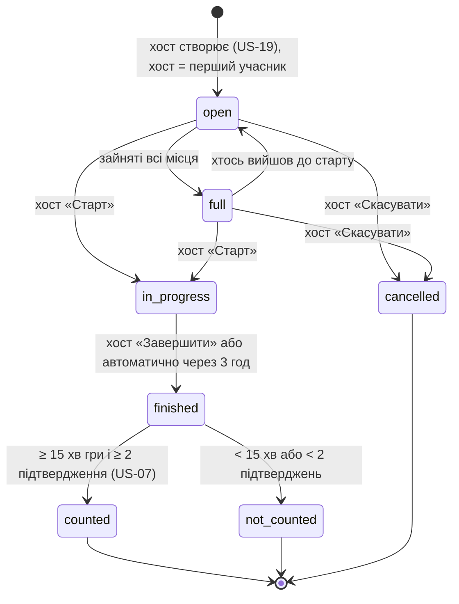
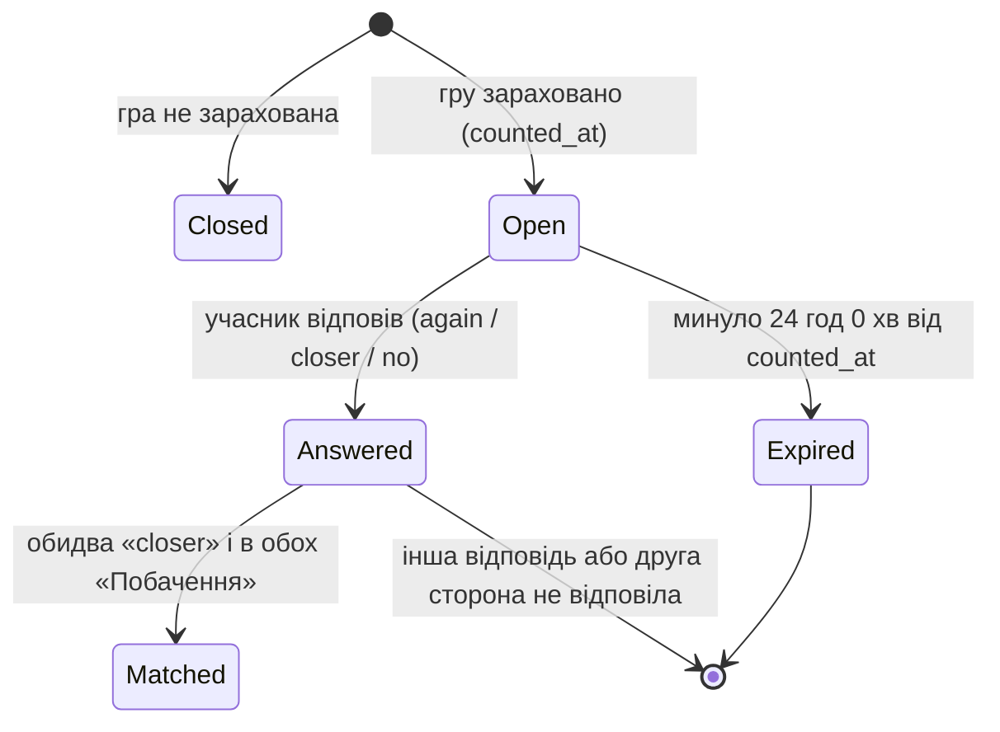
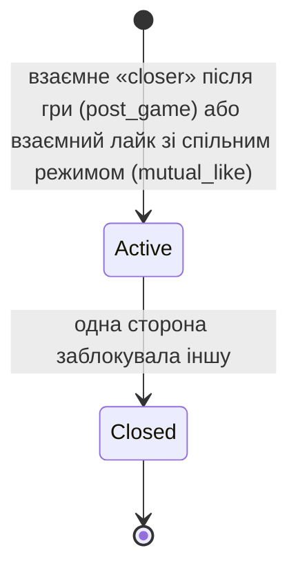
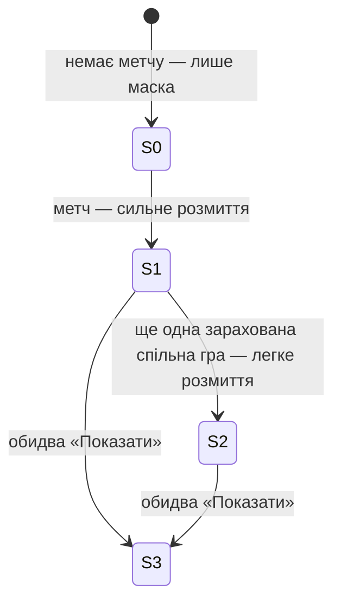
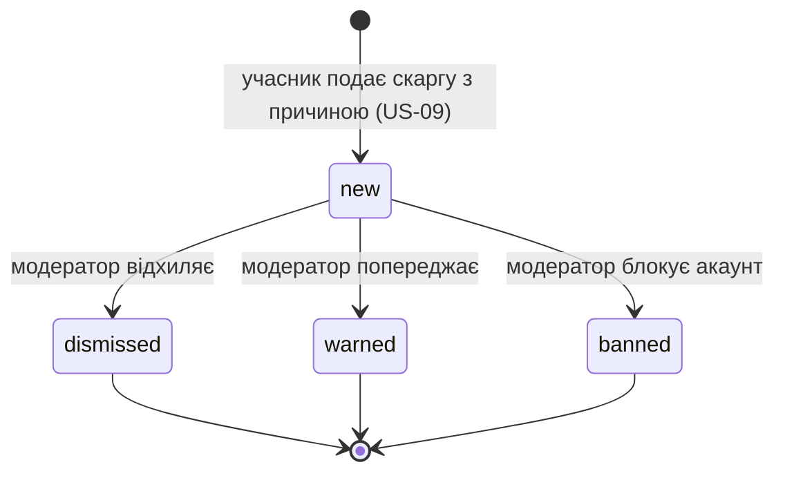

# Технічний аналіз вимог (Requirements Digest)

> **КТ4, крок 1.** Вимоги КТ3 ([requirements.md](requirements.md): 19 історій MVP і 89 сценаріїв Given-When-Then), перекладені мовою розробки: сутності, їхні стани й переходи, суворі правила й заборони, технічні припущення MVP і прогалини.
> Промпт: [prompts/4.1_requirements_digest.md](../prompts/4.1_requirements_digest.md). На цьому документі побудовано [ADR](adr/) і [контракти](contracts/).

**Коротко**

- **15 сутностей:** 13 уже є в прототипі (фото — частково), 2 додаються під історії безпеки: підтвердження гри і скарга з рішенням модератора.
- **6 життєвих циклів:** акаунт, івент, вікно «Зіграємо ще?», метч, стадія фото, скарга.
- **24 бізнес-правила** (BR-01…BR-24) і **10 заборон** (NEVER-01…NEVER-10). Кожне правило має джерело в історії і місце, де його перевіряють.
- **12 прогалин:** 8 розбіжностей між вимогами й прототипом і 4 питання, на які вимоги не відповідають. Для кожної є рішення або власник.

---

## 1. Сутності

Статус: ✅ є в прототипі · 🆕 додається під історії MVP (контракт уже описано в [contracts/data-schema.md](contracts/data-schema.md)).

| Сутність | Таблиця | Що це | Ключові атрибути | Історії | Статус |
|---|---|---|---|---|---|
| Акаунт (User) | `users` | Людина, що входить у застосунок | email (унікальний), хеш пароля, ім'я, дата народження, роль, прапорці `is_premium`, `is_bot` | US-01, US-10 | ✅ (🆕 `role`, `banned_at`) |
| Профіль / Ігрова ДНК | `profiles` | Публічна частина акаунта без фото | маска, режими, роль у грі, стиль, голос/текст, розклад, токсичність | US-02, US-03, US-18 | ✅ |
| Улюблена гра профілю | `profile_games` | Зв'язок профілю з грою | гра, ранг | US-02, US-15 | ✅ |
| Фото | `profiles.photo_*` + файлове сховище | Приватне фото власника і розмиті копії для стадій | ключ оригіналу, ключі копій для стадій 1 і 2 | US-04, US-16 | 🔧 зараз публічний `photo_url`, див. [ADR-0010](adr/0010-private-photo-storage.md) |
| Гра | `games` | Довідник ігор | назва, slug, `is_chill` | US-02, US-19 | ✅ |
| Івент | `events` | Гра в конкретний час із місцями | хост, гра, тип, назва, час, місця, статус, 🆕 `is_official`, `started_at`, `finished_at`, `counted_at` | US-05, US-06, US-07, US-19 | ✅ (🆕 поля) |
| Учасник івенту | `event_participants` | Хто записаний на івент | івент, людина, час запису | US-06, US-08 | ✅ |
| Підтвердження гри | `game_confirmations` | «Ми справді зіграли» від учасника | івент, людина, час | US-07 | 🆕 |
| Відповідь «Зіграємо ще?» | `post_game_feedback` | Таємна відповідь про партнера по грі | івент, від кого, про кого, відповідь | US-11, US-12 | ✅ |
| Свайп | `swipes` | Вподобання або пропуск профілю | від кого, кому, напрям, час | US-13 | ✅ |
| Метч | `matches` | Взаємна симпатія пари | пара (упорядкована), джерело | US-12, US-13 | ✅ |
| Розмова і повідомлення | `conversations`, `messages` | Чат пари з метчем | метч, автор, текст, час | US-14, US-15 | ✅ |
| Стан розкриття фото | `photo_reveals` | Наскільки чітко **моє** фото бачить метч | стадія 0–3, згода, ранній запит | US-16, US-17 | ✅ |
| Блокування | `blocks` | Одна людина заблокувала іншу | хто, кого, коли | US-08 | ✅ |
| Скарга і рішення | `reports` | Скарга в ручну чергу і рішення модератора | автор, на кого, контекст, причина, статус, рішення, модератор | US-09, US-10 | 🆕 |

**Чого немає серед сутностей свідомо:** платежів (Teamate+ — лише прапорець), сповіщень (push поза MVP), «Моїх тіммейтів» (Post-MVP), окремої таблиці Teamate Nights (це звичайний івент з `is_official = true` і хостом із команди).

---

## 2. Життєві цикли

### 2.1. Акаунт

| Перехід | Хто | Умова | Заборонено |
|---|---|---|---|
| → Registered | гість | вік на день реєстрації ≥ 18, email вільний | реєстрація до 18 років; два акаунти на один email |
| Registered → Onboarded | власник | збережено ≥ 1 улюблену гру, роль і ≥ 1 режим | показувати не-онборджений профіль іншим |
| → Banned | модератор | рішення за скаргою | вхід і будь-який запит заблокованого акаунта (`403 ACCOUNT_BANNED`) |

### 2.2. Івент

Цільова машина станів після US-07. Зараз у коді є все, крім автозавершення і стану «зараховано».

`counted` і `not_counted` — не нові значення `status`, а похідна ознака: `status = finished` плюс `counted_at` заповнене чи ні. Так не ламається наявний enum і клієнт.

| Перехід | Хто | Умова | Помилка, якщо порушено |
|---|---|---|---|
| open → full | система | учасників = `max_slots` | |
| open/full → in_progress | лише хост | статус open або full | `HOST_ONLY` 403, `INVALID_TRANSITION` 409 |
| in_progress → finished | хост або таймер | хост натиснув, або минуло 3 год від `started_at` | `INVALID_TRANSITION` 409 |
| finished → counted | система | `finished_at − started_at ≥ 15 хв` і ≥ 2 записи в `game_confirmations` | гра не зараховується, «Зіграємо ще?» не відкривається |
| open/full → cancelled | лише хост | до старту | `INVALID_TRANSITION` 409 |

### 2.3. Вікно «Зіграємо ще?»

Відповідь одна на пару (івент, від кого, про кого) і не змінюється. Одностороння відповідь нікому не показується.

### 2.4. Метч

У момент створення метчу атомарно створюються розмова і два рядки `photo_reveals` зі стадією 1. Пара (A, B) зберігається впорядковано, тож другий метч для тієї самої пари неможливий.

### 2.5. Стадія фото (на кожного учасника метчу окремо)

Стадії ніколи не регресують. Стадію 2 можна пропустити. Одностороння згода не змінює стадію, лише показує іншій стороні «готовий показати».

### 2.6. Скарга

---

## 3. Бізнес-правила

Перевірка: **D** — чиста функція в `app/domain/` (юніт-тест без БД) · **S** — сервіс (API-тест) · **C** — обмеження в БД.

| ID | Правило | Історія | Де перевіряється |
|---|---|---|---|
| BR-01 | Реєстрація лише якщо на день реєстрації виповнилося 18 (17 років 364 дні — ні, рівно 18 — так) | US-01 | D + S |
| BR-02 | Email унікальний без урахування регістру | US-01 | C + S |
| BR-03 | Профіль показується іншим лише після онбордингу: ≥ 1 гра, роль, ≥ 1 режим | US-02 | S |
| BR-04 | У профілі рівно одна маска; за замовчуванням `duelist` | US-18 | C |
| BR-05 | «Побачення» за замовчуванням вимкнено; вмикається й вимикається будь-коли | US-03 | C + S |
| BR-06 | Івент: назва 3–80 символів, місць 2–10, час початку не в минулому, гра з довідника | US-19 | схема + S |
| BR-07 | Хост автоматично стає першим учасником і не може вийти зі свого івенту | US-19 | S |
| BR-08 | Приєднатися можна лише до `open` івенту з вільним місцем і лише один раз | US-06 | D + C |
| BR-09 | Переходи івенту виконує лише хост і лише за машиною станів 2.2 | US-07 | D |
| BR-10 | Івент без дії хоста завершується автоматично через 3 год після старту | US-07 | D + фонова перевірка |
| BR-11 | Гра зараховується лише якщо між стартом і завершенням ≥ 15 хв **і** є ≥ 2 підтвердження | US-07 | D |
| BR-12 | На «Зіграємо ще?» є 24 год від `counted_at`; після 24 год 0 хв відповідь неможлива | US-11 | D |
| BR-13 | Варіант `closer` доступний лише коли в **обох** увімкнено «Побачення» | US-03, US-11 | D |
| BR-14 | Метч після гри — лише при взаємному `closer`; будь-яка інша комбінація метчу не дає | US-12 | D |
| BR-15 | Одна пара людей має не більше одного метчу, звідки б він не прийшов | US-12, US-13 | C (`uq_match_pair`) |
| BR-16 | Лайків без Teamate+ — 20 на добу (за `Europe/Kyiv`); пропуск не рахується | US-13 | D |
| BR-17 | Метч за свайпом — лише при взаємному лайку і спільному режимі | US-13 | D |
| BR-18 | Чат доступний лише двом учасникам метчу; повідомлення від 1 до 2000 символів після обрізання пробілів | US-14 | S |
| BR-19 | Підказка першого повідомлення згадує спільну гру, а для метчу за свайпом — спільну улюблену гру | US-15 | S |
| BR-20 | Стадії фото 0→1→2→3 не регресують; 3 — лише за згоди обох | US-16, US-17 | D |
| BR-21 | Блокування діє в обидва боки: не бачать івентів, профілів і чату одне одного | US-08 | S |
| BR-22 | Якщо обоє записані на той самий майбутній івент, заблокованого виписують | US-08 | S |
| BR-23 | Скарга має обов'язкову причину і контекст (івент, чат або фото) | US-09 | схема |
| BR-24 | Чергу скарг бачать і рішення ухвалюють лише модератори | US-10 | S |

## 4. Заборони (чого система не робить ніколи)

| ID | Заборона | Чому |
|---|---|---|
| NEVER-01 | Не віддавати оригінал фото або посилання на нього нікому, крім власника і метчу на стадії 3 | Ядро цінності продукту і рішення №1 після КТ2 |
| NEVER-02 | Не показувати незнайомцю (стадія 0) навіть розмите фото: лише маску | US-04, US-13 |
| NEVER-03 | Не розкривати односторонню відповідь «Зіграємо ще?» і односторонній лайк: ні в API, ні в WebSocket, ні в лічильниках | Страх відмови «в обличчя» |
| NEVER-04 | Не пускати людей до 18 років ні в які режими | Рішення КТ2, US-01 |
| NEVER-05 | Не повідомляти заблокованому про факт блокування і не пояснювати причину («івент недоступний») | US-06, US-08 |
| NEVER-06 | Не показувати тому, на кого скаржаться, автора скарги | US-09 |
| NEVER-07 | Не віддавати в публічних відповідях email, дату народження, хеш пароля | Приватність (`PublicUser` містить лише вік) |
| NEVER-08 | Не створювати метч без явної взаємної дії обох людей (крім демо-бота Guide, `is_bot = true`) | Згода |
| NEVER-09 | Не змінювати стадію фото на нижчу і не відкривати стадію 3 односторонньо, зокрема платним запитом | ADR-0003 |
| NEVER-10 | Не обходити серверні перевірки на клієнті: будь-яке правило з розділу 3 сервер перевіряє сам | Клієнт можна підробити |

## 5. Технічні припущення MVP

| # | Припущення | Наслідок для коду |
|---|---|---|
| A-01 | Автентифікація: email + пароль (bcrypt), JWT HS256 у заголовку `Authorization: Bearer`, строк дії 7 днів, без refresh-токена | [ADR-0008](adr/0008-jwt-auth.md) |
| A-02 | Ідентифікатори: UUID v4, генерує сервер; у JSON — рядок | Не можна вгадати чужий id перебором |
| A-03 | Час: зберігається в UTC (`timestamptz`), у JSON — ISO 8601 з часовим поясом. «Сьогодні» і денний ліміт лайків рахуються за `profiles.timezone` (за замовчуванням `Europe/Kyiv`) | |
| A-04 | Вік рахується з дати народження, яку людина вказує сама. Документи не перевіряються | Ризик прийнято, селфі-верифікація Post-MVP |
| A-05 | Один процес API, WebSocket-хаб у пам'яті | [ADR-0004](adr/0004-in-memory-ws-hub.md) |
| A-06 | Сховище: SQLite локально, PostgreSQL у Docker; схема з моделей (`create_all`), Alembic — коли з'являться реальні дані | [ADR-0007](adr/0007-relational-db-sqlalchemy.md) |
| A-07 | Фото — локальна приватна папка, видача лише через авторизований ендпоінт | [ADR-0010](adr/0010-private-photo-storage.md) |
| A-08 | Модератор — звичайний акаунт з `role = moderator`, призначається вручну командою (seed) | Окремої адмін-панелі немає, черга — екран у застосунку |
| A-09 | Автозавершення івенту і закриття 24-годинного вікна обчислюються «ліниво» під час запиту (порівняння з поточним часом), без планувальника | Немає Celery/cron, нуль інфраструктури |
| A-10 | Teamate+ — прапорець `is_premium` без оплати | |
| A-11 | Мова інтерфейсу — англійська в коді, документація — українська; помилки мають стабільний `code`, текст `detail` англійською | [contracts/errors.md](contracts/errors.md) |
| A-12 | Пагінація лише для історії чату (`before` + `limit ≤ 100`); стрічки обмежені розміром (≤ 20 карток у Discover) | |

## 6. Знайдені прогалини

### 6.1. Розбіжності між вимогами КТ3 і прототипом

Бізнес-логіку на КТ4 не змінюємо: кожна розбіжність стає задачею наступного етапу, а контракт уже описує цільову поведінку.

| # | Вимога | Що зараз у коді | Історія | Що робимо |
|---|---|---|---|---|
| G-01 | Реєстрація з 18 років | Поріг 13 років (`services/auth.py`) | US-01 | Підняти поріг; код `TOO_YOUNG` уже є |
| G-02 | Маска за замовчуванням `duelist` | За замовчуванням `operator` | US-18 | Змінити default у моделі |
| G-03 | Незнайомець не бачить навіть розмитого фото | `/discover` віддає `photo_url`, файл у `/media` публічний | US-04, US-13, US-16 | ADR-0010, ендпоінт `GET /photos/{user_id}` |
| G-04 | Гра зараховується за 15 хв і 2 підтвердження, автозавершення через 3 год | Івент завершує лише хост, підтверджень немає | US-07 | Таблиця `game_confirmations`, `POST /events/{id}/confirm` |
| G-05 | 24 години на «Зіграємо ще?» | Вікно не обмежене | US-11 | `FEEDBACK_WINDOW_CLOSED` 409 |
| G-06 | `closer` лише коли в обох «Побачення» | Не перевіряється | US-11, US-12 | `CLOSER_REQUIRES_DATING` 422 |
| G-07 | Час початку івенту не в минулому | Не перевіряється | US-19 | `STARTS_IN_PAST` 422 |
| G-08 | Скарги і черга модерації | Немає | US-09, US-10 | Таблиця `reports`, ендпоінти `/reports`, `/moderation/reports` |

### 6.2. Питання, на які вимоги не відповідали

| # | Питання | Рішення команди |
|---|---|---|
| Q-01 | За яким часовим поясом рахувати «сьогодні» і денний ліміт лайків? | За `profiles.timezone`, за замовчуванням `Europe/Kyiv` (A-03) |
| Q-02 | Хто може підтвердити гру: лише учасники чи й хост? | Будь-який учасник, зокрема хост. Хост сам по собі гру не зараховує: потрібні 2 різні люди |
| Q-03 | Що відбувається з активним метчем після блокування? | Метч не видаляється (історія для модерації), але чат закривається (`BLOCKED` 403), а метч зникає зі списків обох |
| Q-04 | Чи можна поскаржитися на демо-бота Guide? | Так, технічно це звичайний акаунт. Скарга потрапляє в чергу як будь-яка інша |

## 7. Відповідність історій і сутностей

| Історія | Сутності | Ключові правила |
|---|---|---|
| US-01 | User | BR-01, BR-02, NEVER-04 |
| US-02, US-18, US-03 | Profile, ProfileGame | BR-03, BR-04, BR-05 |
| US-04, US-16, US-17 | Profile (фото), PhotoReveal, Match | BR-20, NEVER-01, NEVER-02, NEVER-09 |
| US-05, US-06, US-19 | Event, EventParticipant, Game | BR-06, BR-07, BR-08, BR-21 |
| US-07 | Event, GameConfirmation | BR-09, BR-10, BR-11 |
| US-08 | Block, EventParticipant | BR-21, BR-22, NEVER-05 |
| US-09, US-10 | Report, User | BR-23, BR-24, NEVER-06 |
| US-11, US-12 | PostGameFeedback, Match | BR-12, BR-13, BR-14, BR-15, NEVER-03 |
| US-13 | Swipe, Match | BR-15, BR-16, BR-17, NEVER-02 |
| US-14, US-15 | Conversation, Message | BR-18, BR-19 |
